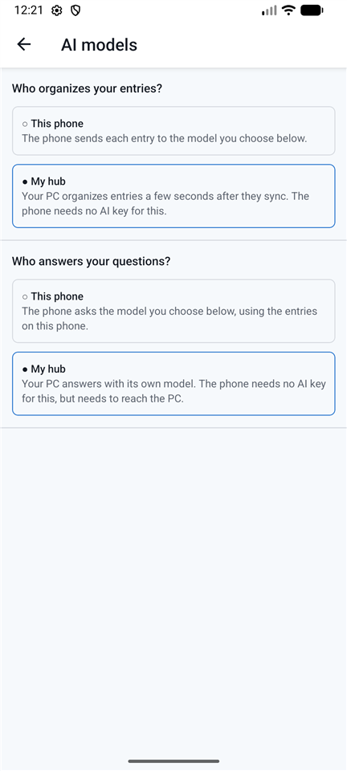
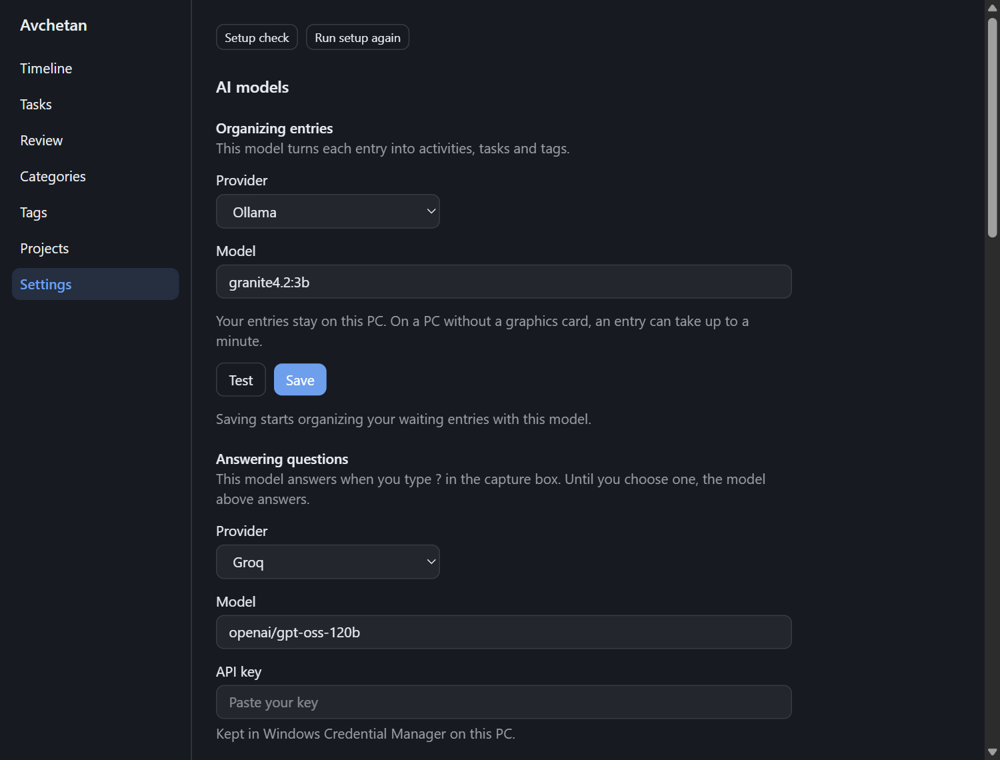

# Choose AI models

> Draft — describes planned behavior. The suggested models are listed in the app and updated with each release.

Avchetan uses AI for three jobs. Each can use a different model:

| Job | What it does | What matters |
|---|---|---|
| **Organizing** | Turns each entry into activities, tasks, categories and tags | Fast and reliable |
| **Answering** | Answers your `?` questions, writes the daily brief | Smart |
| **Searching** | Finds entries by meaning ("knee pain" also finds "stiff leg") | Runs on the hub/server only |

## Free and private: Ollama (on your PC)

- Install [Ollama](https://ollama.com). Avchetan detects it and suggests models.
- Larger models give better answers but need more graphics memory. The hub's model sets say which PC they suit, for example **Ollama on your PC (no graphics card)**.
- Without a working graphics card, Ollama runs on the processor. That still works, but an entry can take up to a minute to organize, and in our tests about one entry in three had a mistake, such as a missed number or wrong date. You can correct these in the main window. A cloud provider is more accurate, but your entries leave your PC.
- If the app says a model isn't downloaded, click **Download it** in the [Setup check](troubleshooting.md#setup-check) (or **Download them** for the hub's models), or choose a model you already have.
- On a phone: let your hub do it, because phones can't run these models. See below.

## Let your hub organize a phone's entries

If your phone syncs with a hub on your PC, the PC can organize the phone's entries, and the phone needs no AI key.

1. On the PC, the hub needs a model. The hub inside Avchetan has one from the set you chose when you turned it on ([Home Hub](setup-home-hub.md)); a hub you run yourself needs `EXTRACTION_PROVIDER` and `EXTRACTION_MODEL`.
2. On the phone, open **More → AI models**.
3. Under **Who organizes your entries?**, tap **My hub**.

New entries show **Pending** until they sync, then come back organized a few seconds later. Entries already waiting are picked up at the next sync. To go back, tap **This phone**; the model you chose before is still there.

If the screen says the phone isn't connected to a hub, set up [Sync](pair-your-phone.md#connect-by-hand) first. Entries wait on the phone until it can reach the hub.

## Let your hub answer a phone's questions

The hub can answer the **Ask** tab's questions too, so the phone needs no AI key at all.

1. On the PC, the hub needs a model for questions. The hub inside Avchetan has one from its set; a hub you run yourself needs `ANALYSIS_PROVIDER` and `ANALYSIS_MODEL`. Without a graphics card, a larger model answers better but can take a minute or more.
2. On the phone, open **More → AI models**.
3. Under **Who answers your questions?**, tap **My hub**.

The phone has to reach the hub to ask. Without a connection, Ask shows today's counts from the phone instead.

## Free cloud providers (bring your own key)

**Groq** has a free tier with daily limits, enough for a personal log. If you reach a limit, your entries wait and are organized later.

**Google Gemini** also has a free tier, but Google's terms say what you send to it can be used to improve its products and read by human reviewers, and that you shouldn't send personal information. Avchetan entries are personal, so use Groq or Ollama for them unless you have a paid Gemini plan.

Other providers, such as Anthropic Claude and OpenAI, are planned for a later version.

1. Create an API key on the provider's website.
2. Open **Settings → AI models**, choose the provider, and paste the key.
3. Click **Test** to check it. Nothing is saved yet, and only a made-up sentence is sent.
4. Click **Save**. Avchetan then starts organizing the entries that are waiting, so they are sent to that provider.

On Android, these settings are under **More → AI models**.

Your key is stored in your device's secure storage (Windows Credential Manager / Android Keystore), never in plain files.

## Privacy

- With Ollama only, your entries never leave your devices and hub.
- With a cloud provider, the text of your entries (and your questions) is sent to that provider to be processed, under that provider's terms. The settings screen shows which jobs use which provider.
- Add `!private` to an entry to keep it away from cloud AI entirely (coming in a later version).
