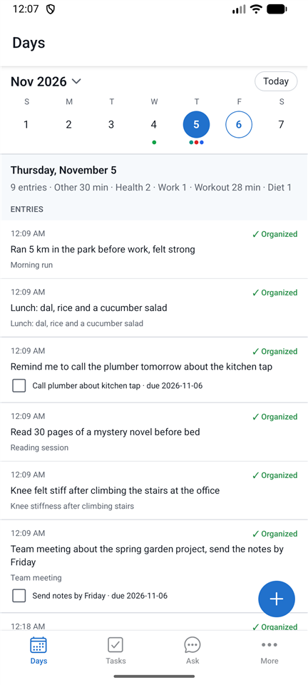
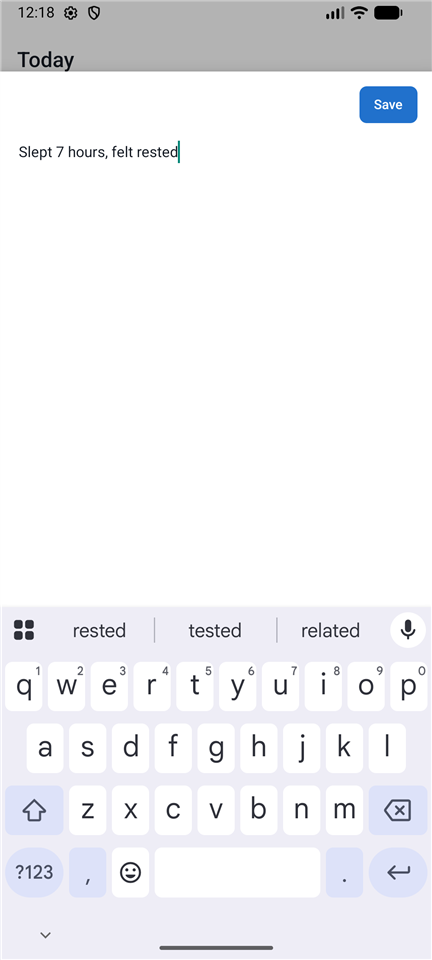
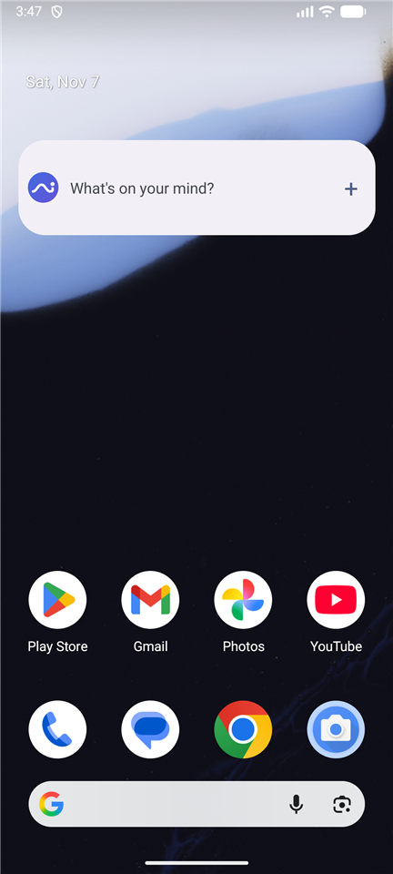
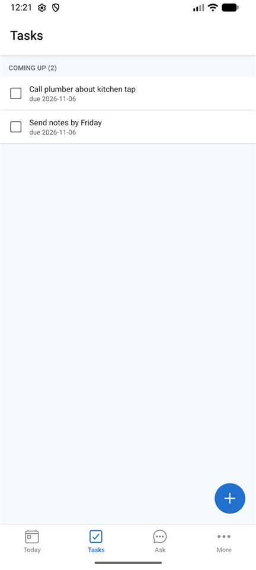
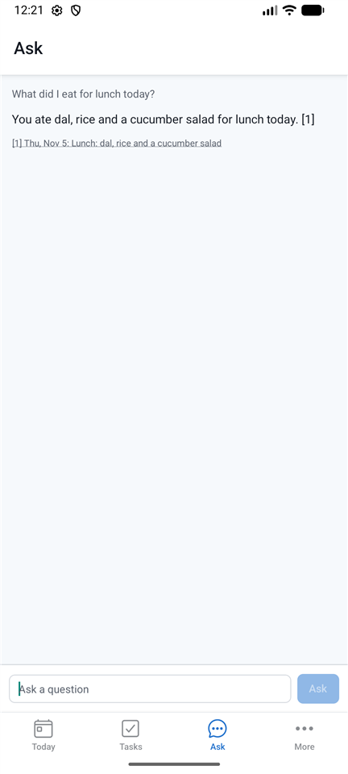

# Use Avchetan on Android

**Goal:** write something down in two seconds, and find it again later.
**You need:** the Avchetan app on your phone. Entries save without a connection, but organizing them needs an AI model.

## Choose an AI model

Until you choose one, your entries are saved and wait.

1. Open **More → AI models**.
2. Under **Organizing entries**, choose a provider and paste your key. See [Choose AI models](ai-models.md) to get a free key.
3. Tap **Test** to check it, then **Save**. Entries that were waiting start organizing.

## Write an entry

1. Tap the **+** button.
2. Type what happened or what you need to do, for example `Walked 30 minutes, call the plumber tomorrow`.
3. Tap **Save**. The entry appears on **Days**, under today, with a *Pending* badge, then changes to *✓ Organized*.

This works without a connection too. The entry waits, and it's organized when you're back online. Opening the app does this right away. With the app closed, Android organizes a few entries at a time every so often, and it decides when.

**Rather talk?** Tap 🎤 in the box and say it; the words appear for you to check before **Save**. It uses the phone's own offline speech recognition: see [Voice](voice.md#on-the-phone).

If you close the box without saving, your text is still there the next time you open it, unless the app has fully closed.

## Add the widget

The **Quick capture** widget puts a *What's on your mind?* bar on your home screen. Tap it, type, tap **Save**, and you're back on the home screen. The widget never shows your entries.

1. Touch and hold an empty part of your home screen, then tap **Widgets**.
2. Find **Avchetan** and drag **Quick capture** to your home screen (on some phones, tap it and then **Add**).
3. To make it narrower or wider, touch and hold it, then drag its edges.

Tapping the bar opens the same box as **+**, with the keyboard up. Tapping the widget's 🎤 opens it already listening ([Voice](voice.md#on-the-phone)). **Back** keeps your text for next time and also returns to the home screen.

If tapping the widget does nothing (for example after you used **Force stop** on Avchetan in the phone's settings), open Avchetan once. The widget works again after that.

## Look back by day

**Days** shows one day at a time: its [daily brief](daily-brief.md) in the evening (until then, how many entries and totals such as *Workout 45 min*), the tasks due or done that day, and the entries.

- **Another day:** tap it in the week at the top. Swipe the week left or right for the next or previous week.
- **The whole month:** tap the month name, or swipe down on the week. Swipe up to go back to one week.
- **Back to today:** tap **Today**.
- **Dots** under a date show what that day had: one colour per category (up to three), grey for entries that aren't organized yet.
- An entry that talks about another day ("yesterday I ran 5 km") shows on that day too, marked *added on* the day you wrote it.
- Days ahead show the tasks due then. Tasks past their due date show on today as one red line, **▸ 3 overdue**; tap it to see them, and again to fold them away. The phone remembers which you chose.
- **Sync now:** pull **Days** down. The phone sends what is waiting and gets what your other devices added.
- If entries have waited a day without reaching your hub, a yellow note at the top of **Days** says since when and how many wait, with what to check. It goes away by itself after the next sync ([server_unreachable](troubleshooting.md#server_unreachable)).

## Add tags and keep entries private

- Type `#` before a word to tag the entry: `#health`, or `#health/knee` for a tag inside another tag.
- Type `!private` anywhere in the entry to keep it from online AI: only an AI on your own PC or hub reads it. A 🔒 shows before it on **Days**. More in [Private entries](ai-models.md#private-entries).
- **Always private for some topics:** add tags such as `health` under **More → Private tags**. Any entry you tag `#health`, or `#health/knee`, is then private without typing `!private`.
- **Change it later:** open the entry and tap **Make private** or **Make normal**.

## Tags and projects

An entry's tags show under it on **Days**; tap one to open the tag's page. **More → Tags** and **More → Projects** list them all. A tag's or project's page shows how many entries and open tasks it has, when it was first and last used, the totals of its three most used numbers (*distance: 42 km this month · 318 km in all*; ratings such as mood show their average), its open tasks, and its entries by day, newest first. Tap a date to open that day; **Show more** adds 50 entries. A tag's page includes the tags nested under it (`#health` takes `#health/knee`). Renaming, merging and adding projects are on the PC.

## Trends

**More → Trends** draws one of your numbers over time, the same as on the PC ([Trends](capture-on-windows.md#trends)).

- Tap the first chip to pick a number (distance, sleep, body weight…; the most used come first), and **Everything** to narrow it to one category or tag (with the tags under it).
- Pick **4 weeks** (a bar per day), **3 months** (a bar per week) or **1 year** (a bar per month). Amounts such as distance or minutes are added up in each bar; ratings and readings such as mood, sleep or weight are averaged. A day with nothing logged has no bar.
- Under the chart: the total or average and the change on the same length of time before.
- **Tap a bar** for its exact value and its activities; tap an activity to open its day with the entry outlined.

## The More tab

**More** is grouped: **Your stuff** (Routines, Reminders, People, Tags, Projects, Trends), **AI and capture** (AI models, Voice, Daily brief, What Avchetan learned), **Privacy** (App lock, Private tags), **Connection and data** (Sync, Your data, Setup check) and **Help** (User guide, Report a problem, Log, Run setup again). **Log** shows what the app did since you opened it; its **Detailed log for 1 hour** adds each request, sync step and entry organized when you are asked for a detailed log ([Send a log](troubleshooting.md#send-a-log)).

## Change or fix an entry

Tap an entry on **Days** to see what was found in it.

- **Organize again:** try again, for example after you choose a better model.
- **Edit text:** change what you wrote. The entry keeps its original time and is organized again.
- **Delete entry:** remove it, along with everything found in it.
- **Edit** under an activity: change its title or pick another category.
- **The numbers line** under an activity (*Duration: 40 min*), or **+ Add numbers**: change, add or remove its numbers ([Fix the numbers](corrections.md#fix-the-numbers)).
- **Delete** under an activity: remove only that activity.
- Tap a task to change it, finish it, move it or delete it (see [Tasks](#tasks)).

Fixing what Avchetan found teaches it for next time ([Teach Avchetan with your fixes](corrections.md)).

If something went wrong, the reason appears under the entry with a **Help** link.

## Tasks

Tasks found in your entries appear on the **Tasks** tab: *Overdue*, *Today*, *Coming up*, *No date*, *Waiting on others*, and *Done or cancelled*.

- Tap the box to mark a task done; tap it again to open the task again.
- **Swipe a task right** to mark it done, or **left** to move it to tomorrow. **Undo** shows at the bottom for 10 seconds. With TalkBack, the same two are in the task's actions.
- Tap the task to:
  - change its name or due date (to move it to any day, write the date like `2026-11-25`), or delete it. A deleted task can be brought back with **Undo** for 10 seconds.
  - **Mark done** with a note on how it went (optional).
  - Save how much is **partly done**, from 1 to 99%. The task stays open and shows *40% done*.
  - **Move** it to **Tomorrow** or **Next week** (the Monday after this week).
  - **Remind me** at a day and time; the task shows it (*⏰ Today 16:00*). **Change reminder** or **No reminder** changes it. Moving the task moves its reminder too ([Reminders](reminders.md)).
  - **Cancel task**: it's struck through and never counted as missed. Use **Delete** instead when it was never a task.
  - **Reopen** a done or cancelled task.
  - **Repeat** makes a task come back: every few days, on chosen weekdays, monthly or yearly, as for routines. The task shows how it repeats (*↻ Every week on Monday*). When you mark one done or cancel it, the next one appears with its date; finishing one late never adds the days you missed, the next is today at the earliest. Moving one doesn't change the others. **Change repeat** edits the rule, **Stop repeating** ends it and leaves the tasks you have. Repeating tasks don't appear under Routines.
- A done task shows how it went: *Done on time*, *Done 2 days late* or *Done 1 day early*, and your note.
- Each group shows how many it holds and its first 50; tap **Show more** for the next 50. People and a person's entries work the same way.

## Routines

**More → Routines** lists your regular chores and schedule. Tap **New routine**, or a routine to change it:
- **Tick it off** is for chores you do, such as watering the plants. **Assumed** is for things that happen unless an entry says otherwise, such as sleep or work hours.
- **Repeats every** day, week, month or year, with **How many** for every 2 or 3. Weekly picks the days; monthly and yearly pick a day number (the 31st falls back to a shorter month's last day) or a weekday such as *the last Friday*. **Ends** never, on a date, or after a number of times.
- **At a time** adds a time window such as *23:00–07:00* (it may end the next morning).
- **Pause** stops it without losing it; **Delete** can be undone for 10 seconds from the bar at the bottom.

The first time you open Routines it offers **ideas** (drink water, walk or exercise, water plants, sleep, work hours and more). Nothing is added until you turn one on and tap **Add**; **Ideas** brings the list back later. A routine's day appears each day it falls on, from the day you add it; past days are never filled in.

**Ticking chores off.** Each day's *Tick it off* routines show as one **Chores** list on **Days**, with how many are done (*Chores · 2 of 5*). Tap the box to tick one, tap again to untick it; tap its name to open the routine. Assumed routines such as sleep don't appear there.

**Ticked from what you write.** When an entry says you did one of the day's chores (*watered the plants* while *Water plants* is open), it is ticked for you once the entry is organized, and shows *from your entry*. Tap **Undo** if it was wrong; it then stays unticked. Plans (*need to water the plants*) and other days (*yesterday*) tick nothing. A private entry is only matched by an AI model on your own hardware, like everything private.

**Day coverage** (off unless you turn it on: **Show day coverage in Days** at the bottom of **More → Routines**, for this device only) adds a card on **Days** with how much of the day is accounted for, such as *19 h 30 min of 24 h accounted for · 4 h 30 min unaccounted*, a bar, and what it is made of: what you logged with a duration (*walked for 30 minutes*), the sleep you logged, your *Assumed* routines that have a time window (*Sleep 8 h*, *Work hours 8 h*; a day marked skipped doesn't count, and overlapping windows count once), and 15% of the day for small things nobody logs. Logged sleep replaces an assumed *Sleep* routine for that day. Today counts only the hours gone by (*of 10 h 30 min so far*); days ahead show nothing. The rest is *unaccounted*, never *wasted*: an hour you didn't log may well have been rest. A duration logged inside your work hours counts twice, but the day never goes past 24 h.

**Evening reminder.** At the bottom of **More → Routines**, **Remind me about chores left** sends one notification in the evening, only on days something is still unticked; tapping it opens Days. It is on at 20:00 unless you change it, and it is set for this phone only. It stays quiet when the phone doesn't ring for reminders (**More → Reminders**, see [Reminders](reminders.md)). Turning it on asks Android to allow notifications; if you refuse, it stays off and the screen says how to allow them later in Android's settings.

## Search

Tap the magnifier at the top of **Days** or **Tasks** and type a word, or the start of one: *dent* finds *dentist*, and with several words all must be there. Results come in groups: **Entries** (the found words marked), **Tasks** and **People**. Tap an entry to open its day with the entry outlined, a task to open **Tasks**, or a person to open their page; your search is still there when you come back.

The chips under the box narrow it: when (*Any time*, *This week*, *This month*, *This year*, or *Pick dates*, typed like `2026-11-01`), a tag, a category, a project or a person. **Clear** removes them. People aren't filtered, so they're hidden while a filter is on.

When the phone syncs with a hub that has search on, **Similar entries** adds close matches the hub finds by meaning, with the same filters. Offline, or without a hub, it isn't shown.

## Ask about your entries

Open the **Ask** tab and type a question, like `how many workouts this week?`. The answer lists the entries it used, and you can tap one to open it.

To answer, your question and the entries it needs are sent to your AI model. Without a connection, you'll get today's activity and open task counts from your phone instead.

**Times.** Ask knows what time each entry was saved. When your words say you are doing it now or just did it (`now going to sleep`, `just finished lunch`), that counts as when it happened, so you can ask `? when did I go to sleep`. Otherwise (`ran this morning`), write the time if it matters (`woke up at 6:05`): the answer reads it from the text. Working out how long you slept from two entries is a best guess for now; sleep hours of their own are planned (see the [roadmap](../roadmap.md#v050--tasks-routines-and-reminders)).

**Dates and big totals.** A question about a period (`? when did my knee hurt in March 2025`) searches that period, however many newer entries use the same words. A total counts at most the newest 5,000 matching activities; past that, the answer says the real number may be higher.

**Search by meaning.** If your hub has a search model (see [Home Hub](setup-home-hub.md#search-by-meaning)), a question like `when did my knee hurt` also finds entries that say "stiff leg" or "physio". Without a hub, or when it can't be reached, Avchetan searches for the words you used.

