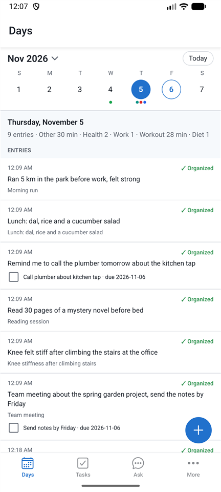
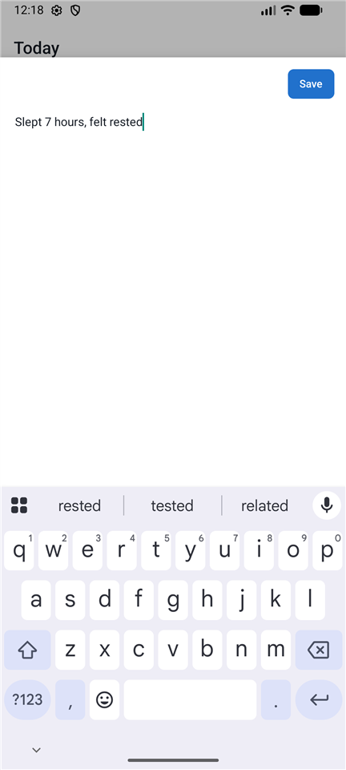
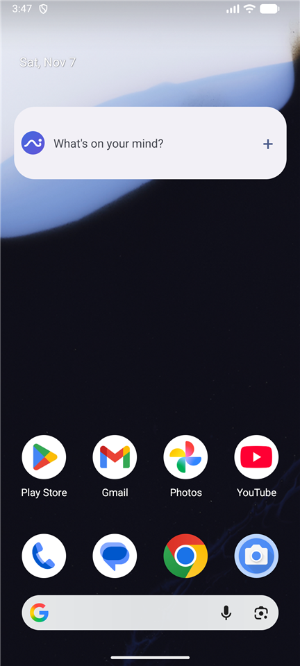
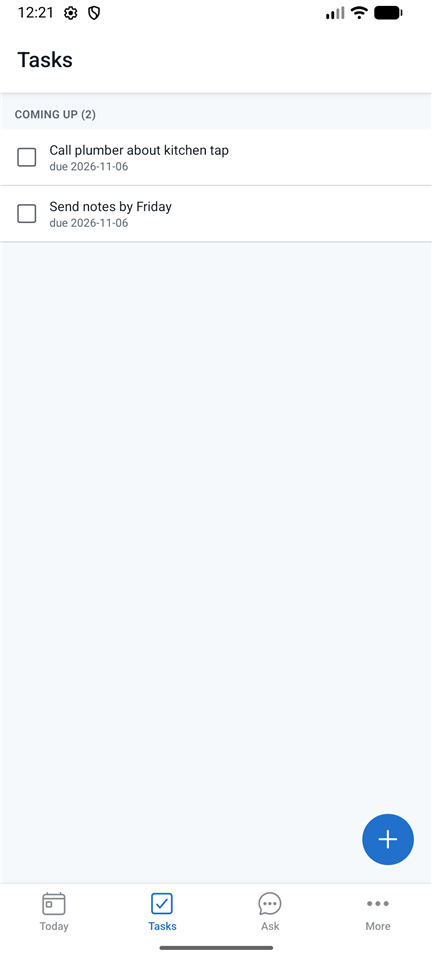
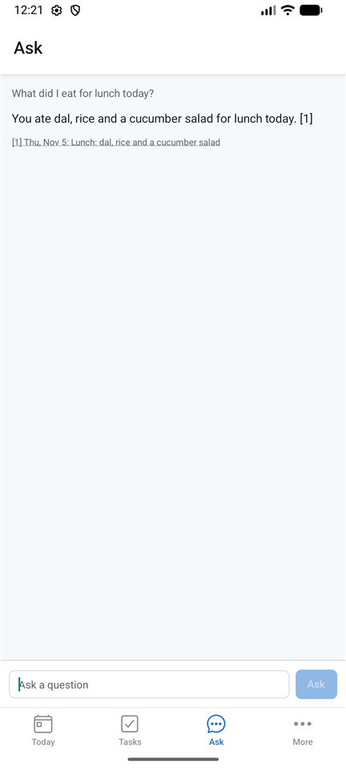

# Use Avchetan on Android

**Goal:** write something down in two seconds, and find it again later.
**You need:** the Avchetan app on your phone. Entries save without a connection, but organizing them needs an AI model.

## Choose an AI model

Until you choose one, your entries are saved and wait.

1. Open **More → AI models**.
2. Under **Organizing entries**, choose a provider and paste your key. See [Choose AI models](ai-models.md) to get a free key.
3. Tap **Test** to check it, then **Save**. Entries that were waiting start organizing.

## Write an entry

1. Tap the **+** button.
2. Type what happened or what you need to do, for example `Walked 30 minutes, call the plumber tomorrow`.
3. Tap **Save**. The entry appears on **Days**, under today, with a *Pending* badge, then changes to *✓ Organized*.

This works without a connection too. The entry waits, and it's organized when you're back online. Opening the app does this right away. With the app closed, Android organizes a few entries at a time every so often, and it decides when.

**Rather talk?** Tap 🎤 in the box and say it; the words appear for you to check before **Save**. It uses the phone's own offline speech recognition: see [Voice](voice.md#on-the-phone).

If you close the box without saving, your text is still there the next time you open it, unless the app has fully closed.

## Add the widget

The **Quick capture** widget puts a *What's on your mind?* bar on your home screen. Tap it, type, tap **Save**, and you're back on the home screen. The widget never shows your entries.

1. Touch and hold an empty part of your home screen, then tap **Widgets**.
2. Find **Avchetan** and drag **Quick capture** to your home screen (on some phones, tap it and then **Add**).
3. To make it narrower or wider, touch and hold it, then drag its edges.

Tapping the bar opens the same box as **+**, with the keyboard up. Tapping the widget's 🎤 opens it already listening ([Voice](voice.md#on-the-phone)). **Back** keeps your text for next time and also returns to the home screen.

If tapping the widget does nothing (for example after you used **Force stop** on Avchetan in the phone's settings), open Avchetan once. The widget works again after that.

## Look back by day

**Days** shows one day at a time: its [daily brief](daily-brief.md) in the evening (until then, how many entries and totals such as *Workout 45 min*), the tasks due or done that day, and the entries.

- **Another day:** tap it in the week at the top. Swipe the week left or right for the next or previous week.
- **The whole month:** tap the month name, or swipe down on the week. Swipe up to go back to one week.
- **Back to today:** tap **Today**.
- **Dots** under a date show what that day had: one colour per category (up to three), grey for entries that aren't organized yet.
- An entry that talks about another day ("yesterday I ran 5 km") shows on that day too, marked *added on* the day you wrote it.
- Days ahead show the tasks due then. Tasks past their due date show on today as one red line, **▸ 3 overdue**; tap it to see them, and again to fold them away. The phone remembers which you chose.
- **Sync now:** pull **Days** down. The phone sends what is waiting and gets what your other devices added.
- If entries have waited a day without reaching your hub, a yellow note at the top of **Days** says since when and how many wait, with what to check. It goes away by itself after the next sync ([server_unreachable](troubleshooting.md#server_unreachable)).

## Add tags and keep entries private

- Type `#` before a word to tag the entry: `#health`, or `#health/knee` for a tag inside another tag.
- Type `!private` anywhere in the entry to keep it from online AI: only an AI on your own PC or hub reads it. A 🔒 shows before it on **Days**. More in [Private entries](ai-models.md#private-entries).
- **Always private for some topics:** add tags such as `health` under **More → Private tags**. Any entry you tag `#health`, or `#health/knee`, is then private without typing `!private`.
- **Change it later:** open the entry and tap **Make private** or **Make normal**.

## Change or fix an entry

Tap an entry on **Days** to see what was found in it.

- **Organize again:** try again, for example after you choose a better model.
- **Edit text:** change what you wrote. The entry keeps its original time and is organized again.
- **Delete entry:** remove it, along with everything found in it.
- **Edit** under an activity: change its title or pick another category.
- **Delete** under an activity: remove only that activity.
- Tap a task to change it or delete it.

Fixing what Avchetan found teaches it for next time ([Teach Avchetan with your fixes](corrections.md)).

If something went wrong, the reason appears under the entry with a **Help** link.

## Tasks

Tasks found in your entries appear on the **Tasks** tab: *Overdue*, *Today*, *Coming up* and *No date*.

- Tap the box to mark a task done.
- Tap the task to change its name or due date, or to delete it. Write dates like `2026-11-25`.

## Ask about your entries

Open the **Ask** tab and type a question, like `how many workouts this week?`. The answer lists the entries it used, and you can tap one to open it.

To answer, your question and the entries it needs are sent to your AI model. Without a connection, you'll get today's activity and open task counts from your phone instead.

**Search by meaning.** If your hub has a search model (see [Home Hub](setup-home-hub.md#search-by-meaning)), a question like `when did my knee hurt` also finds entries that say "stiff leg" or "physio". Without a hub, or when it can't be reached, Avchetan searches for the words you used.

