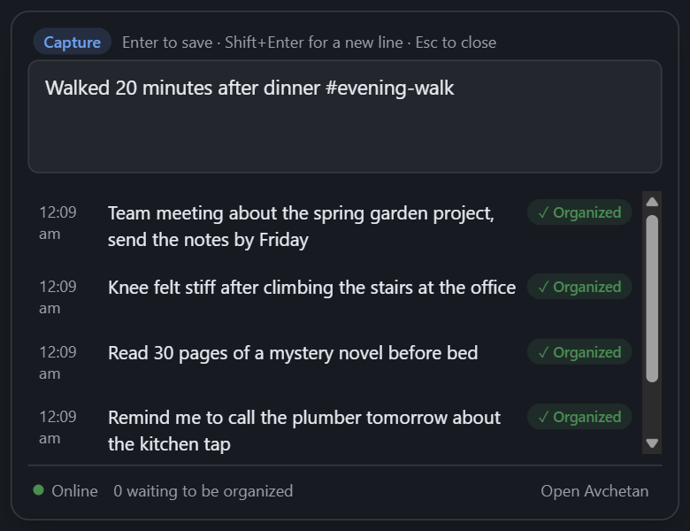
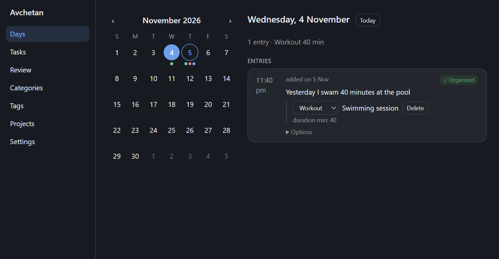
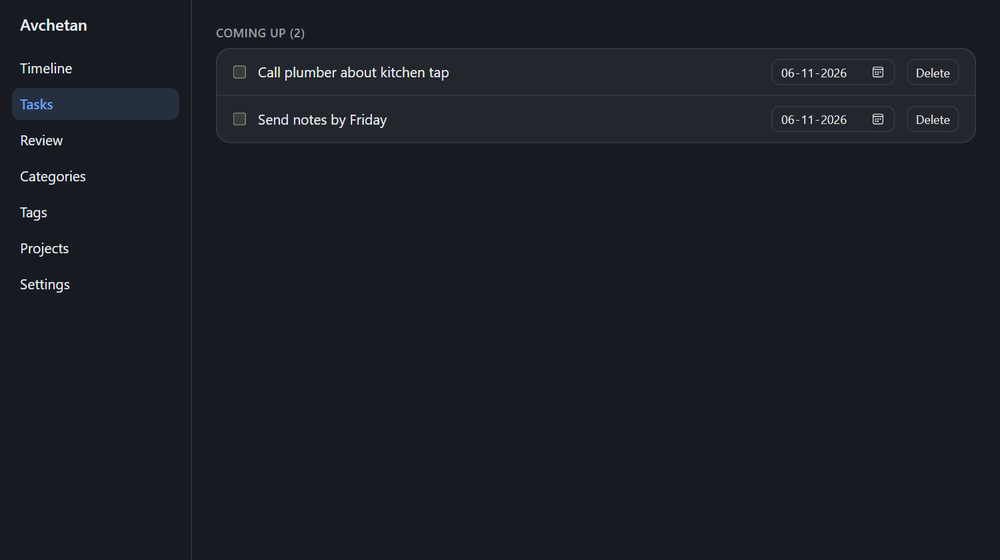

# Capture on Windows

**Goal:** write something down in two seconds, from any app.
**You need:** Avchetan running (its icon is in the system tray, near the clock).

## Write an entry

1. Press **Ctrl+Shift+Space**, from any app. A bar opens in the upper part of your screen. On Windows 11 the desktop shows through it, blurred; on Windows 10 it is a plain panel.
2. Type what happened or what you need to do, for example `Walked 30 minutes, remind me to buy milk tomorrow`.
3. Press **Enter** to save it. The box empties and says *✓ Saved · Ctrl+Z to take back* for a few seconds; the entry appears underneath, *Pending* until the AI has organized it, then *Organized*.
4. Press **Esc** (or click anywhere else) to close the box. Esc first steps back out of a list or an answer: see [Use the box with the keyboard](#use-the-box-with-the-keyboard).



Need more than one line? Press **Shift+Enter** to start a new line; the bar grows with it.

The chip at the left of the box says what Enter will do, and changes as you type:

| Chip | When |
|---|---|
| ✎ **Entry** | Plain text: saved as an entry |
| 🔒 **Private** | The text has `!private` or a [private tag](#add-tags-and-keep-entries-private): saved as a private entry |
| ? **Ask** | The text starts with `?`: a [question](#ask-about-your-entries) |
| / **Command** | The text starts with `/`: a [command](commands.md) |
| 🔍 **Find** | The text starts with `/find`: a search |

The list under the box (your latest entries, a list of commands, an answer) shows only when there is something in it.

While you type, chips under the box show what Avchetan reads from your text, with no AI: the tags (with 🔒 when a tag makes the entry [private](#add-tags-and-keep-entries-private)) and the dates your day words mean, such as *tomorrow → Sun, 15 Nov*. A weekday on its own shows both its coming and its last date (*friday → Fri, 20 Nov or Fri, 13 Nov*): the AI picks by what you wrote (*will* or *did*). They are only hints; the AI still organizes the entry afterwards.

Half-written text is kept, even if you close the box or restart your PC.

## Use the box with the keyboard

You can type as soon as the box opens, and after you click anything in it the keyboard goes back to the text box.

| Key | What it does |
|---|---|
| **↓** in an empty box | Moves into the list underneath: your latest entries, or the sources of an answer |
| **↓** while typing a command | Moves to the next command in the list (the first, the best match, is already lit) |
| **↑ / ↓** | Moves through the list; **↑** on the first row goes back to the box |
| **Enter** on an entry | Opens that entry's day in **Days** |
| **Enter** on a command | Runs it (a command that needs words, such as `/done`, is filled in for you to finish) |
| **Tab** | Fills in the lit command (`/ulk` → `/unlock `) |
| **Ctrl+Z** in an empty box | Takes back the entry you just saved, like `/undo`. With text in the box it undoes typing as usual |
| **Esc** | One step back: leaves the list, then closes an answer, then closes the box |

Typing a letter while a row is highlighted goes into the box as usual.

**Rather talk?** Hold the shortcut instead of pressing it, or press 🎤 in the box, and say it. The text appears in the box for you to check. It works offline once you've downloaded a speech model in **Settings → Voice**: see [Voice](voice.md#on-the-pc).

## Add tags and keep entries private

- Type `#` before a word to tag the entry: `#health`, or `#health/knee` for a tag inside another tag.
- Type `!private` anywhere in the entry to keep it from online AI: only an AI on your own PC or hub reads it. A 🔒 shows before it on **Days**. More in [Private entries](ai-models.md#private-entries).
- **Always private for some topics:** add tags such as `health` under **Settings → AI → Private tags**. Any entry you tag `#health`, or `#health/knee`, is then private without typing `!private`.
- **Change it later:** open the entry's **Options** on **Days** and click **Make private** or **Make normal**.

## Window context and rules

When you press the shortcut, Avchetan notes which app you were in and its window title, for example *Visual Studio Code · api.ts — my-project*. It shows under the box, and the entry keeps it: **Days** shows *from Visual Studio Code* under the entry, and the AI uses it as a hint.

- **Don't keep it for one entry:** click **×** at the end of that line before you save.
- **Pause it for an hour:** right-click the tray icon → **Pause window context for 1 hour**. While paused, the same item says until when and resumes it early. It turns back on by itself.
- **Turn it off:** **Settings → Capture box → Window context → Note the window I was in**.
- **Browsers:** only the browser's name is kept, never the page you're on, unless you turn on **Keep page titles in browsers**.
- **Apps never noted:** password managers (1Password, Bitwarden, KeePass, KeePassXC, Dashlane, LastPass) are on the list under **Never note these apps**. Nothing at all is kept for them. Add any app by its file name, or from **Recent apps**, which lists the apps you used the shortcut over lately.
- Opening the box from the tray icon notes nothing: the window in front then is the taskbar.

**Rules** file entries for you. A rule says: in this app, with a title like this, the entry belongs to this project and gets these tags. For example *App* `Code.exe`, *Title contains* `my-project`, *Project* Engineering, *Tags* `my-project`.

1. Open an entry's **Options** on **Days** and click **Make a rule from this**. The app and the whole title are filled in.
2. Shorten the title to the part that matters, choose a project (or **New project…** to add one there) and add tags. The form says whether the rule still matches that entry.
3. Click **Add rule**.

From then on, an entry typed over a matching window gets the tags as if you had typed them, and everything found in it goes to that project, whatever the AI thinks. The line under the box says what a rule adds (*rule: Engineering · #my-project*). Rules are listed under **Settings → Capture box → Window context → Rules**, where you can turn one off, change it or delete it. Changing a rule doesn't change entries you've already saved.

For one rule that covers all your projects, tick **Pattern** and name a part of the title: `— (?<project>[^—]+) — Visual Studio Code` with the tag `{project}` tags every entry with the folder you have open.

## Attach the clipboard

Copied an error message, a link or a few lines of code? Press **Ctrl+Shift+Alt+Space** instead of the usual shortcut. The box opens with what you copied attached, shown on a second line: *Clipboard · TypeError: Cannot read…*. Type your entry and save as usual.

- **See all of it:** click the line. At most 4 KB is kept; longer text is cut, and the entry says so.
- **Don't keep it:** click **×** at the end of that line before you save. The window line stays.
- **Box already open?** Press the same shortcut: the clipboard is attached, and what you typed stays.
- **Text only.** Images and files are never attached. If there is nothing to attach, the line says why for a moment (*Clipboard has no text*, *Clipboard is empty*).
- **Passwords:** password managers mark what they copy as private, and Avchetan never attaches it (*Not attached: the clipboard came from an app that marks it private*). Over an app under **Never note these apps**, nothing is attached either.
- **Pausing window context doesn't stop it:** this shortcut is something you press on purpose.
- **The AI sees the first 1 KB** as a hint, for example to name the error in a task. A `!private` entry's clipboard is never sent to any AI.
- **Later:** **Days** shows *with clipboard* under the entry; click it to see the text and **Copy** it. On the phone, open the entry and long-press the text to copy it.
- **Change or turn off the shortcut:** **Settings → Capture box → Clipboard snap**. It can't be the same as the capture box's own shortcut.

The clipboard is read only at the moment you press this shortcut, never otherwise.

## Change the keys

Open Avchetan (tray icon → **Open Avchetan**) → **Settings**. Settings has tabs across the top: **AI**, **Capture box**, **Voice**, **Daily brief**, **Privacy**, **Hub & sync**, **Your data** and **General**. It opens on the tab you used last. Typing `/settings voice` (or any tab's name) in the capture box opens a tab directly.

On **Capture box**:
- **Shortcut:** type a new one, for example `Ctrl+Alt+Space`, and click **Save**. If another app already uses it, Avchetan says so and keeps the old one.
- **Clipboard snap:** the shortcut that [attaches the clipboard](#attach-the-clipboard), changed the same way, or turned off.
- **Saving an entry:** choose whether **Enter** saves and **Shift+Enter** starts a new line (the default), or the other way round. Swap them if you often write entries longer than one line.

On **General**:
- **Start with Windows:** leave this on so the shortcut works right after you sign in.
- **Time zone:** Avchetan follows Windows. Choose a zone here if your entries should use a different one. A day ends at midnight.

## Ask about your entries

Start with `?` and press your save key:

```
? how many workouts did I do this week
? when did my knee hurt
? what tasks are overdue
```

A question is never saved as an entry. The answer appears in the box with the entries it came from, numbered like `[1]`. Avchetan does the counting itself, so totals come from your data, not from a guess.

**Search by meaning.** If your hub has a search model (see [Home Hub](setup-home-hub.md#search-by-meaning)), a question like `when did my knee hurt` also finds entries that say "stiff leg" or "physio". Without a hub, or when it can't be reached, Avchetan searches for the words you used.

Your question, and the entries needed to answer it, go to the model chosen under **Settings → AI → AI models**. Private entries are only read by a model on your own PC. They stay out of a cloud model's answers, so those answers can leave them out.

When you're offline with a cloud model, Avchetan shows a short count from your PC instead.

## Run a command

Start with `/` to act instead of log: `/done foam roll` marks a task done, `/brief` makes today's brief, `/sync` syncs, `/undo` takes back the last entry you saved or the last command, `/settings` opens Settings, and `/lock` and `/unlock` work the [app lock](app-lock.md). See [Commands in the capture box](commands.md).

## See what was organized

Open Avchetan (tray icon → **Open Avchetan**):

- **Days:** one day at a time, under its week, which stays at the top while you scroll. Click the month and year above the week (or press M) to see the whole month; pick a day or press Esc to close it. Each date has dots in its categories' colours (grey: not organized yet). The day shows its [daily brief](daily-brief.md) (on Sundays also the [Your week](daily-brief.md#your-week-sundays) card), or until there is one a summary such as *3 entries · Workout 45 min*, its tasks (due, done, and on today the overdue ones, folded into one red line such as **▸ 3 overdue** until you click it; Avchetan remembers whether you left it open), and its entries with the activities and tasks found in them. Use ← and → for the day before or after, ‹ and › for a week, Page Up and Page Down for a month, and T for today. An entry about another day ("yesterday I ran") shows on that day too, marked *added on*. Click a title to change it, change the category next to it, or click **Edit numbers** to fix its minutes, km and other numbers ([Fix the numbers](corrections.md#fix-the-numbers)). Avchetan never overwrites what you changed, and learns from it for similar entries ([Teach Avchetan with your fixes](corrections.md)). **Options** under an entry lets you organize it again, edit its text, or delete it.
- **Search** (or **Ctrl+F** anywhere in the window): finds the words you typed in your entries, tasks and people, on this PC, with no AI. The start of a word is enough (*dent* finds *dentist*); with several words, all must be there. Matching words are marked. Click an entry to open its day with the entry outlined, a task to open **Tasks**, or a person to open their page. Your search stays when you come back, and **Show more** adds 50 results at a time. Esc clears the box. See [Find an entry](#find-an-entry).
- **Tasks:** tick things off and set due dates. **Person…** on a task marks it as a promise to someone, or something you're waiting on them for. Each group shows how many it holds and its first 50; **Show more** adds 50 more. People and a person's entries work the same way.
- **People:** everyone your entries name, with what you owe them and what they owe you ([People and promises](people.md)).
- **Review:** entries that couldn't be organized, and why. Press **Organize now** to try again.
- **Categories:** rename, merge or archive them. The AI adds a category, marked **New**, only when nothing fits; press **Keep** or merge it into another.
- **Tags:** merge or recolor them, or click one to open [its page](#tag-and-project-pages), where you can rename or nest it (`health/knee`). Tags also show under each entry on **Days**; click one to open its page.
- **Projects:** list what you're working on. Entries are linked to a project only if it's listed here. Click a project to open [its page](#tag-and-project-pages), where you can rename it.





## Find an entry

Press **Ctrl+F** in the main window and type a word, or the start of one. Results come in three groups: **Entries** (with their date, category and tags), **Tasks** (open or done, and when due) and **People**. Private entries are included, because the main window only opens while the app is unlocked.

**Narrow it down** with the lists under the box: when (*Any time*, *This week*, *This month*, *This year*, or *Pick dates*), a tag (its nested tags count too: `#health` takes `#health/knee`), a category, a project or a person. An entry counts when it, or something organized from it, has that tag, category, project or person; a task's date is its due date, or the day it was made. People aren't filtered, so they're hidden while a filter is on. **Clear filters** puts them all back.

Search looks for the words themselves, not their meaning: *ran* doesn't find *jogged*. When this PC syncs with a hub that has search on, a second group, **Similar entries**, adds entries the hub finds by meaning (*swimming* can find *went to the pool*), after the word results and with the same filters. It only lists close matches, so it's often empty, and it isn't shown offline or without a hub. To ask in your own words, use [Ask](#ask-about-your-entries).

Press **?** anywhere in the main window (outside a text field) for a list of its keys.

## Tag and project pages

Click a tag (on **Tags**, or under an entry on **Days**) or a project (on **Projects**) to see everything that carries it:

- **At the top:** how many entries and open tasks it has, when it was first and last used, and the totals of its three most used numbers, this month and in all, for example *distance: 42 km this month · 318 km in all*. Amounts such as distance, minutes or steps are added up; ratings and readings such as mood, pace or body weight show their average.
- **Open tasks** with that tag or project. Tick them off here.
- **Entries by day**, newest first, with the same rows as **Days**. Click a date to open that day. **Show more** adds 50 entries at a time.

A tag's page includes the tags nested under it: `#health` also shows entries tagged `#health/knee`. An entry counts when it, or something organized from it, has the tag or project. Click the name at the top to rename it.

## Trends

**Trends** in the sidebar draws one of your numbers over time as bars.

- **Pick a number** from the ones in your entries (distance, sleep, body weight…), most used first. **In** narrows it to one category or one tag (with the tags under it).
- **Pick a range:** **4 weeks** (a bar per day), **3 months** (a bar per week, from Monday) or **1 year** (a bar per month). The last bar is today, this week or this month so far.
- Amounts such as distance, minutes or steps are **added up** in each bar; ratings and readings such as mood, sleep hours or body weight are **averaged**. A day with nothing logged has no bar (it is not counted as zero).
- Under the chart: the range's total or average and how it changed from the same length of time before, for example *42 km in all · up 6 km (17%) on the 4 weeks before*.
- Point at a bar to see its exact value. **Click a bar** (or use ← and → once a bar has focus) to list its activities underneath; click one to open its day with the entry outlined. **Show as a table** lists every bar's number.

A number the AI got wrong shows wrong here too: fix it with **Edit numbers** on **Days** ([Fix the numbers](corrections.md#fix-the-numbers)). Nothing to show yet? Log *ran 5 km* or *slept 7 hours* and it appears.

## Check it worked

Press your shortcut, type `Test entry #test` and press your save key. The entry appears at the top of the list, and *Open Avchetan* shows it under today in **Days**.

## Common problems

- **Nothing happens when I press the shortcut.** Another app may use it. The box shows a warning the next time you open it from the tray. See [hotkey_unavailable](troubleshooting.md#hotkey_unavailable).
- **A yellow note on Days: *Not synced with your hub since …*.** Entries on this PC have waited a day for a hub or server it can't reach. Check that the hub's PC is on with Avchetan running and that both are on the same network (or Tailscale), then click **Sync now**. The note goes away by itself after a sync. See [server_unreachable](troubleshooting.md#server_unreachable).
- **"Couldn't save this entry."** See [db_query_failed](troubleshooting.md#db_query_failed).
