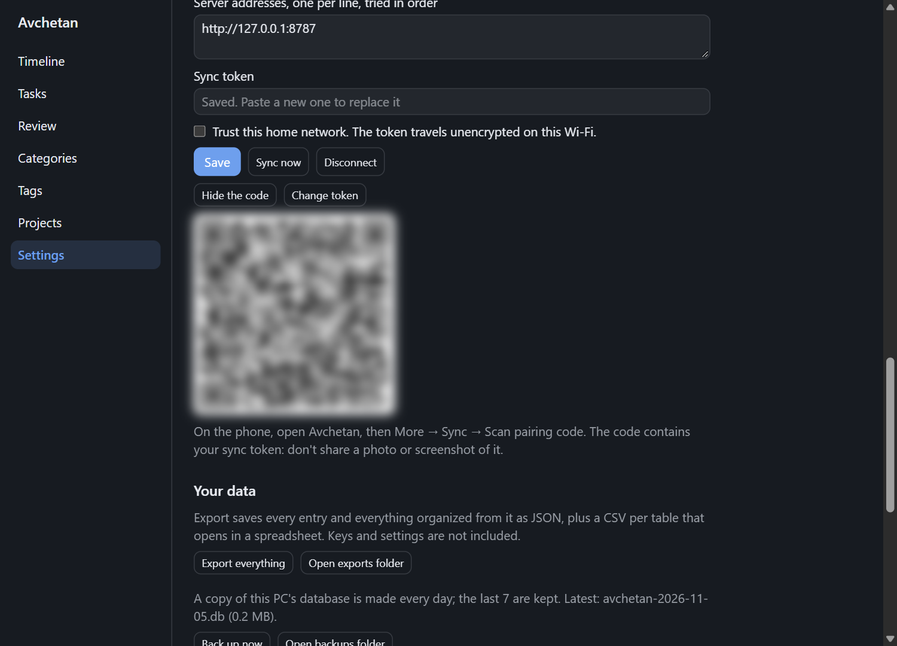
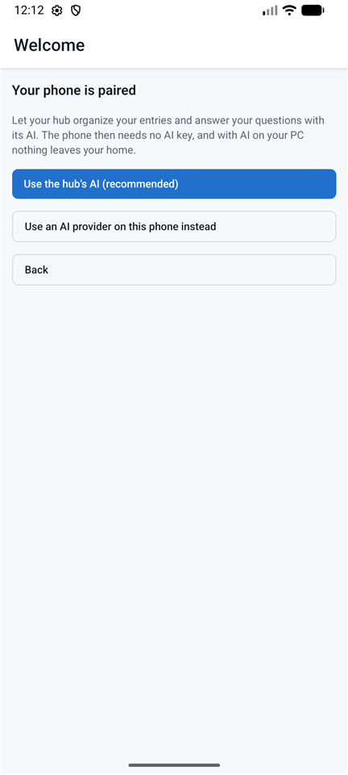

# Pair your phone

**Goal:** connect the Avchetan phone app to your hub (or cloud server) by scanning a QR code.

The PC must already be connected to the hub (in Home Hub mode, the hub runs on that PC).

1. On the PC: open Avchetan → **Settings → Sync → Pair a phone**. A code appears.

2. On the phone: install Avchetan from the [GitHub Releases page](https://github.com/tulsiram-sunrise/avchetan/releases/latest) (download the `.apk` file, open it, and allow installing from your browser when Android asks; [step by step](install-and-update.md#android)). Open it, tap **Connect to my hub or server**, then **Scan the pairing code**. On a phone already set up, go to **More → Sync → Scan pairing code**. Allow the camera when Android asks.
3. Point the camera at the code. The phone checks which of the hub's addresses it can reach, saves them with the token, and starts syncing. It says **Paired with your hub** when it's done.
4. Choose how the phone uses AI. The welcome screen offers **Use the hub's AI (recommended)** right after pairing; later, it's in **More → AI models**:

   - **My hub** (recommended for Home Hub), for organizing entries and for answering questions: your PC does the work. The phone needs no AI keys.
   - **This phone**: choose a provider and paste an API key.
5. On the PC, click **Hide the code**.

If the phone says it couldn't reach the hub, check that both are on the same Wi-Fi and that Windows lets the hub through its firewall, then tap **Scan again**.

## Connect by hand

If you can't scan the code, for example on a second PC, type the details in instead:

1. Find your server's address, such as `http://192.168.1.20:8787`, and its sync token. For a hub on your PC: in **Settings → Sync**, click **Pair a phone**, then **Can't scan? Show the details**. A hub you started from a terminal or Docker prints the token once, the first time it starts.
2. On the phone, open **More → Sync**. On the PC, open **Settings → Sync**.
3. Enter the address and paste the token. For an address on your home network, turn on **Trust this home network**.
4. Tap **Save**. The screen should say **Up to date.** within a few seconds.

After that, a change made on one device shows on the other within about half a minute. The phone sends its changes when you leave the app, and fetches new ones as soon as you open it.

**Stopped syncing after the PC restarted?** Your router may have given the PC a new address. Pair again: show the code on the PC and scan it on the phone. It replaces the old address. To stop this happening, reserve the PC's address in your router's settings (often called *DHCP reservation*).

## Check it worked

On the phone, **More → Sync** says **Up to date.**, and your existing entries appear.

## Notes

- The code contains a secret. Don't share a photo or screenshot of it. If you think it leaked: on the PC, **Settings → Sync → Change token**, then pair your other devices again.
- To pair another phone, repeat these steps.
- For syncing away from home, set up [Tailscale](remote-access-tailscale.md) **before** pairing, so the QR code includes your Tailscale address too. (Or pair again afterwards.)
