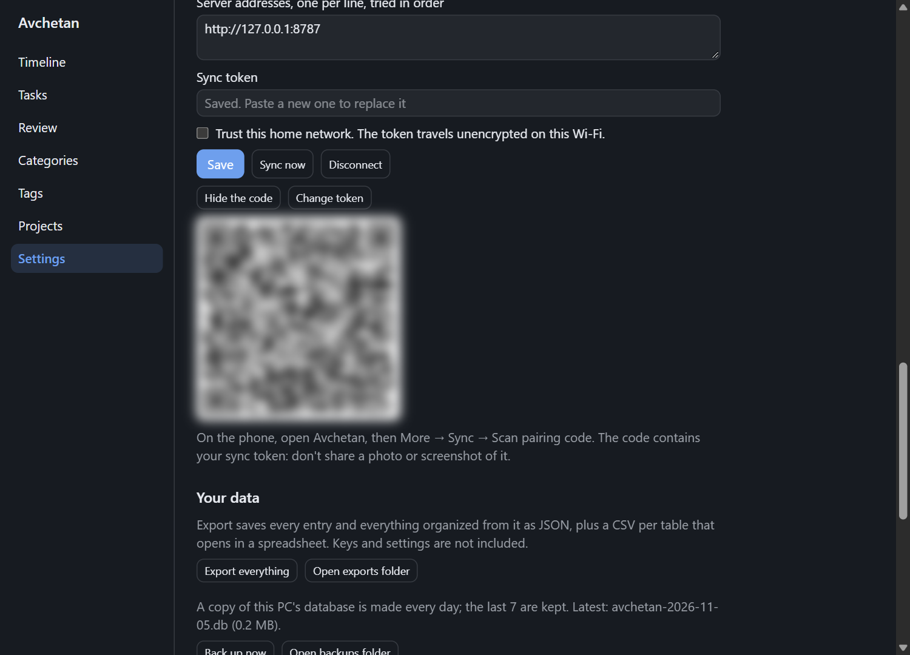
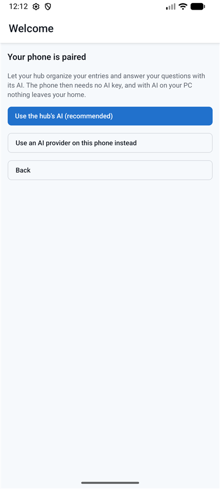

# Pair your phone

**Goal:** connect the Avchetan phone app to your hub (or cloud server) by scanning a QR code.

The PC must already be connected to the hub (in Home Hub mode, the hub runs on that PC).

1. On the PC: open Avchetan → **Settings → Hub & sync → Sync → Pair a phone**. A code appears.

2. On the phone: install Avchetan from the [GitHub Releases page](https://github.com/tulsiram-sunrise/avchetan/releases/latest) (download the `.apk` file, open it, and allow installing from your browser when Android asks; [step by step](install-and-update.md#android)). Open it, tap **Connect to my hub or server**, then **Scan the pairing code**. On a phone already set up, go to **More → Sync → Scan pairing code**. Allow the camera when Android asks.
3. Point the camera at the code. The phone checks which of the hub's addresses it can reach, saves them with the token, and starts syncing. It says **Paired with your hub** when it's done.

   Pairing trusts your home network, as the PC's wizard does: at home, the sync token travels unencrypted on your Wi-Fi to the hub. Pair only on your own Wi-Fi.
4. Choose how the phone uses AI. The welcome screen offers **Use the hub's AI (recommended)** right after pairing; later, it's in **More → AI models**:

   - **My hub** (recommended for Home Hub), for organizing entries and for answering questions: your PC does the work. The phone needs no AI keys.
   - **This phone**: choose a provider and paste an API key.
5. On the PC, click **Hide the code**.

If the phone says it couldn't reach the hub, check that both are on the same Wi-Fi and that Windows lets the hub through its firewall, then tap **Scan again**.

## Connect by hand

If you can't scan the code, for example on a second PC, type the details in instead:

1. Find your server's address, such as `http://192.168.1.20:8787`, and its sync token. For a hub on your PC: in **Settings → Hub & sync → Sync**, click **Pair a phone**, then **Can't scan? Show the details**. A hub you started from a terminal or Docker saves the token it made in a file instead of printing it ([Home Hub without the desktop app](setup-home-hub.md)).
2. On the phone, open **More → Sync**. On the PC, open **Settings → Hub & sync → Sync**.
3. Enter the address and paste the token. For an address on your home network, turn on **Trust this home network**.
4. Tap **Save**. The screen should say **Up to date.** within a few seconds.

After that, a change made on one device shows on the other within about half a minute. The phone sends its changes when you leave the app, and fetches new ones as soon as you open it.

**Stopped syncing after the PC restarted?** Your router may have given the PC a new address. Pair again: show the code on the PC and scan it on the phone. It replaces the old address. To stop this happening, reserve the PC's address in your router's settings (often called *DHCP reservation*).

## Check it worked

On the phone, **More → Sync** says **Up to date.**, and your existing entries appear.

With a long history the first download takes a few minutes (50,000 entries took under 5 minutes in our test). **Days** shows *Downloading your history… 12,000 of 50,000* with a bar; you can keep using the app meanwhile, and older days fill in as they arrive. If the phone loses Wi-Fi or you close the app, the download goes on from where it stopped next time.

## Changed on two devices

If you change the same thing on the phone and on your PC before they sync (say, you move a task's due date on the phone while offline and rename it on the PC), the change made last wins on both, as before. The device whose change lost now tells you: **Days** and **Tasks** show *Changed on two devices* with the task, entry, activity or routine, and what differs (*on this phone* and *kept from the other device*).

- **Keep this one** puts this device's version back. It syncs like any edit and wins on every device.
- **Keep the other** keeps the version that won and hides the notice.

Only changes you made by hand count, and only fields you can see (marking a task done on both devices shows nothing). The notice goes away by itself if you edit the same thing again. It appears on the device that synced **second**: if the device that changed it first had already synced, its change is replaced without a notice, as before.

**An entry's words** work a little differently. Editing an entry's words saves a new version of the entry, so if you edit the same entry on both devices before they sync, both versions are kept side by side, and both devices show *Changed on two devices* with the two texts (*Words*). **Keep this one** deletes the other version, with what was organized from it, on every device; **Keep the other** deletes this device's version. Pick on one device only: the notice on the other device goes away once they sync.

## Notes

- The code contains a secret. Don't share a photo or screenshot of it. If you think it leaked, see [If your sync token leaked](troubleshooting.md#token_stolen).
- To pair another phone, repeat these steps.
- For syncing away from home, set up [Tailscale](remote-access-tailscale.md) **before** pairing, so the QR code includes your Tailscale address too. (Or pair again afterwards.)
- With Avchetan closed, the phone checks in the background about every 15 minutes. It sends new entries, gets other devices' changes at most once an hour, and organizes entries only when its AI model answers. When it can't reach your PC (you're out, no Tailscale), it waits quietly and catches up once you're back, so it doesn't drain your battery.
