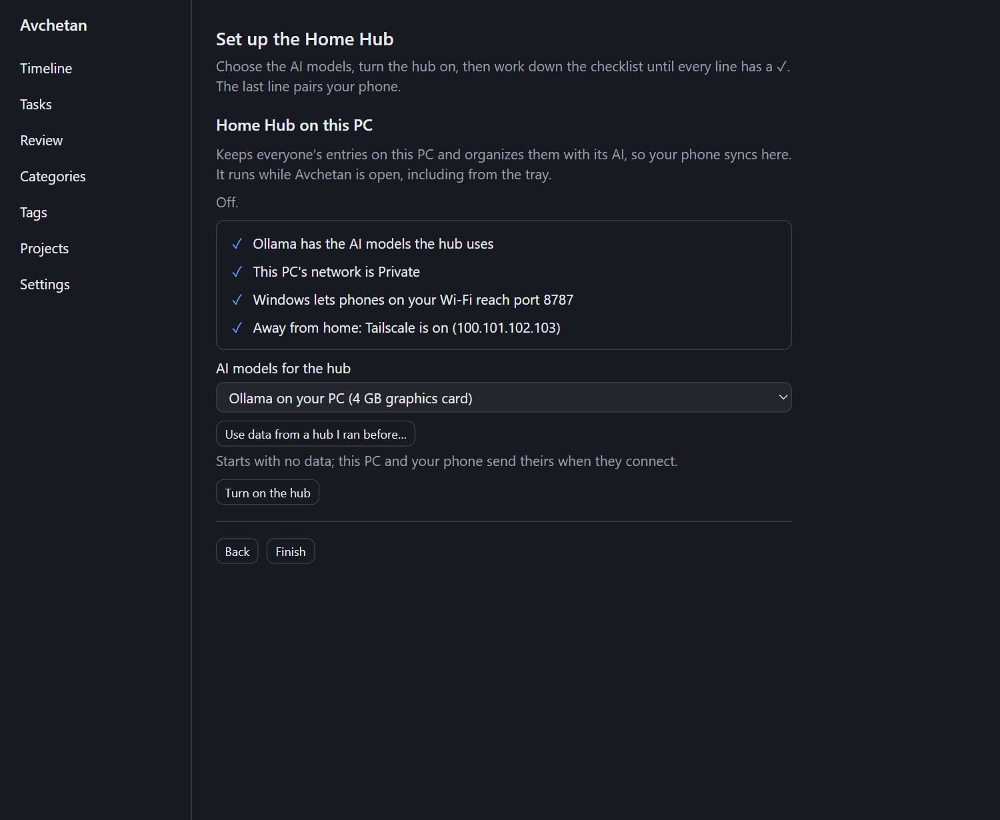
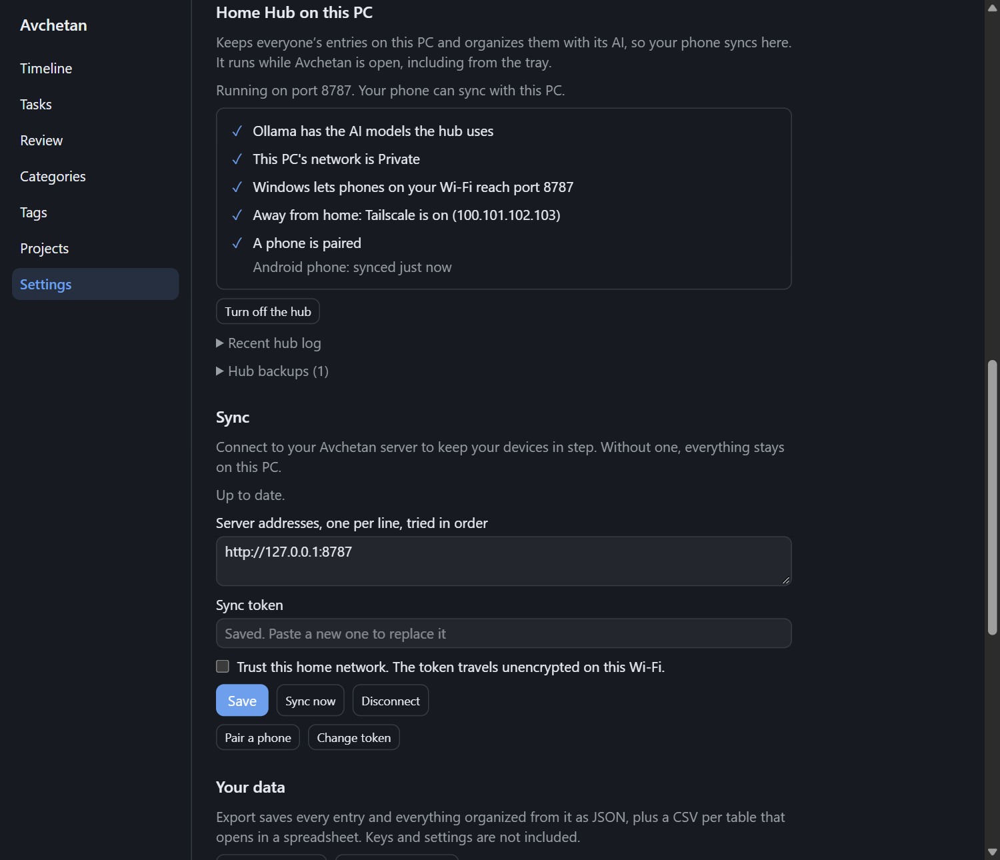

# Setup: Home Hub (your PC + your phone, free and private)

**Goal:** your PC stores your data and runs the AI, and your phone syncs with it. No monthly cost; with local AI models nothing leaves your home.

**You need:**
- A Windows PC that is on most of the day. A graphics card with 8 GB or more of memory makes the AI fast; without one it still works, just slower.
- The free [Ollama](https://ollama.com) app installed on the PC.
- An Android phone on the same Wi-Fi (for setup).

No terminal is needed: Avchetan runs the hub itself and walks you through the rest.

## Part 1 — Set up the hub on your PC

1. Install [Ollama](https://ollama.com/download) and open it once. It runs in the background afterwards.
2. Download the Avchetan installer (the file ending in `windows-x64-setup.exe`) from the [GitHub Releases page](https://github.com/tulsiram-sunrise/avchetan/releases/latest), and run it. If Windows says **Windows protected your PC**, click **More info**, then **Run anyway**: the installer isn't signed with a certificate yet ([why, and how to check the file](install-and-update.md#windows)).
3. Avchetan opens on **Welcome to Avchetan**. Choose **Home Hub on this PC**. If you set Avchetan up before, open **Settings** (tray icon → **Preferences**) and find **Home Hub on this PC** instead.
4. Under **AI models for the hub**, choose the set that fits your PC, for example **Ollama on your PC (no graphics card)**.


5. If you ran a hub before (from a terminal or Docker) and want to keep its entries, click **Use data from a hub I ran before…** and choose its `pglite-data` folder. Phones paired with it keep syncing.
6. Click **Turn on the hub**. The first start takes about 15 seconds while it sets up its database; then it says **Running on port 8787**. If another program already uses that port, click **Use another port** ([hub_port_in_use](troubleshooting.md#hub_port_in_use)); **Port** under the status changes it later.
7. Work down the checklist until every line has a ✓:
   - **Ollama needs models** — click **Download them** and wait. It's a few GB.
   - **Your network is set as Public** — click **Open network settings** and set your home network to **Private**.
   - **Windows' firewall blocks phones** — click **Allow phones to connect**, then **Yes** when Windows asks.
   - **Tailscale** is optional, for syncing away from home ([Tailscale](remote-access-tailscale.md)).



The hub runs whenever Avchetan is open, including when only its tray icon is showing, and starts again with it. If it stops unexpectedly, Avchetan starts it again.

The hub also organizes the entries you type on this PC and answers its questions, unless you chose a model for this PC itself before turning it on. To change it later, open **Settings → AI → AI models** and choose **This PC** or **My hub** under **Who organizes your entries?** and **Who answers your questions?** ([AI models](ai-models.md#let-your-hub-organize-a-phones-entries)).

## Part 2 — Connect your phone

The checklist's last line says **No phone is paired with the hub yet**. Click **Pair a phone** there, and on the phone open **More → Sync → Scan pairing code** (on a new phone: **Connect to my hub or server**, then **Scan the pairing code**). When the phone has synced, the line says **A phone is paired**, with its name and when it last synced. Details: [Pair your phone](pair-your-phone.md).

Can't scan the code? Click **Can't scan? Show the details** under it and type the address and token in instead ([Connect by hand](pair-your-phone.md#connect-by-hand)).

Optional: **Turn on the app lock** above **Finish** locks Avchetan with Windows Hello ([app lock](app-lock.md)). Then click **Finish**. If you finish while the hub is still off, the button says **Finish without the hub**: turn it on later in **Settings → Hub & sync → Home Hub on this PC**.

## Check it worked

1. On the phone, add an entry: `Slept 7 hours, felt rested`.
2. It shows on the PC too, organized: within a minute or so on a PC without a graphics card.
3. On the phone, ask: `? how did I sleep this week`. The answer comes from your PC.

## Good to know

- **PC off or asleep?** The phone keeps working and saves everything. It syncs as soon as it can reach the PC again.
- **Away from home?** Set up [Tailscale](remote-access-tailscale.md) (free) to sync from anywhere.
- **Backups** of the hub run every night automatically ([details](backup-and-restore.md)).
- **Mixing in cloud AI:** you can still use a paid AI provider for some tasks ([AI models](ai-models.md)).

## Search by meaning

The hub can find entries by what they mean, not only the words in them, so Ask can answer `when did my knee hurt` from an entry that says "stiff leg". It needs a search model in Ollama on the PC, about 640 MB. The hub's Ollama model sets include one (`qwen3-embedding:0.6b`), so **Download them** in the checklist gets it too.

For a hub you [run from a terminal](#run-the-hub-from-a-terminal-instead) or [with Docker](#run-the-hub-on-a-home-server-instead-docker):

1. Run `ollama pull qwen3-embedding:0.6b` once.
2. Set `EMBEDDING_PROVIDER=ollama` and `EMBEDDING_MODEL=qwen3-embedding:0.6b`: in the `.env` file for a hub run from a terminal, or the same way as the other settings for Docker. Then start the hub again.

The first start goes through all your existing entries, about 0.2 seconds each on a processor. After that each new entry is ready for search a few seconds after it syncs. Private entries are only searchable with a model on your own PC, like this one.

## Common problems

| Problem | Fix |
|---|---|
| **Ollama isn't running on this PC** | Open the Ollama app once, then click **Check again**. |
| Phone can't connect | Both devices must be on the same Wi-Fi. Check that every line of the hub's checklist has a ✓, or run **Settings → General → Setup check**. For a hub run from a terminal, see [Let your phone reach the PC](#let-your-phone-reach-the-pc). |
| Entries stay "pending" on the phone | The phone can't reach the hub. They are processed automatically once it can. After a day, **Days** shows a note saying since when; pull **Days** down to try again. |
| Answers are slow | Choose a smaller model set for the hub, or choose **This PC** and a model for this device in **Settings → AI → AI models**. |

More: [Troubleshooting](troubleshooting.md).

## Run the hub from a terminal instead

For developers, or to run the hub without the desktop app. It needs [Git](https://git-scm.com/download/win), [Node.js](https://nodejs.org) 24 or newer and **PowerShell**, once, for about 30 minutes.

### Download the AI models

Install [Ollama](https://ollama.com/download) and open it once. In PowerShell, run:

```powershell
ollama pull granite4.2:3b
ollama pull granite4.2:8b
ollama pull qwen3-embedding:0.6b
```

They take about 8 GB of disk in total. The small one organizes entries, the larger one answers questions, and the last one makes [search by meaning](#search-by-meaning) work. Without a graphics card they still work: organizing an entry takes about 30 seconds and an answer about 2 minutes.

### Get Avchetan

```powershell
git clone https://github.com/tulsiram-sunrise/avchetan.git
cd avchetan\avchetan-code
npm install -g pnpm
pnpm install
```

### Tell the hub which models to use

1. Run `copy apps\server\.env.example apps\server\.env`, then `notepad apps\server\.env`.
2. Fill in these lines, leave the rest as they are, and save:

   ```
   EXTRACTION_PROVIDER=ollama
   EXTRACTION_MODEL=granite4.2:3b
   ANALYSIS_PROVIDER=ollama
   ANALYSIS_MODEL=granite4.2:8b
   EMBEDDING_PROVIDER=ollama
   EMBEDDING_MODEL=qwen3-embedding:0.6b
   ```

The `.env` file holds no secrets, unless you add a cloud AI key to it. Never share it if you do.

### Start the hub

```powershell
pnpm --filter @avchetan/server start:hub
```

On the first start it prints **Your sync token**. Copy it somewhere safe: it's shown only once. The hub is ready when it shows `listening`. Keep the window open; closing it stops the hub.

If Windows asks whether to allow **Node.js** on networks, tick **Private networks** only, untick **Public networks**, and click **Allow**.

### Let your phone reach the PC

1. Open Windows **Settings → Network & internet → Wi-Fi**, click your home network, and set **Network profile type** to **Private**. Do this only for your home network.
2. Open PowerShell **as administrator** (right-click → **Run as administrator**) and run:

   ```powershell
   New-NetFirewallRule -DisplayName "Avchetan hub" -Direction Inbound -Protocol TCP -LocalPort 8787 -Profile Private -Action Allow
   ```

   This allows only the hub's port, and only on private networks, so other people on a café or office Wi-Fi can't reach it.

If you ever clicked **Cancel** when Windows asked about Node.js, Windows added a rule that blocks it: open **Windows Defender Firewall → Advanced settings → Inbound Rules**, and delete the **Node.js** rules with a red block sign.

### Connect the PC's app, then your phone

1. In Avchetan on the PC, open **Settings → Hub & sync → Sync**. Enter `http://127.0.0.1:8787`, paste the sync token, and click **Save**.
2. Pair your phone: [Pair your phone](pair-your-phone.md).
3. On the phone, open **More → AI models** and set both **Who organizes your entries?** and **Who answers your questions?** to **My hub** ([AI models](ai-models.md#let-your-hub-answer-a-phones-questions)).

After a restart, open PowerShell in the `avchetan\avchetan-code` folder and run `pnpm --filter @avchetan/server start:hub` again. The token stays the same. Your data is in `apps\server\pglite-data`, and a snapshot is saved each day in `apps\server\pglite-backups` ([Back up and restore](backup-and-restore.md)).

## Run the hub on a home server instead (Docker)

For a machine that is always on, such as a home server or a second PC, without the desktop app. This needs [Docker](https://docs.docker.com/get-started/get-docker/) and a terminal.

1. Download the Avchetan source code from the project's GitHub page and open a terminal in its `avchetan-code` folder.
2. Run `docker compose -f deploy/home-hub/compose.yml up -d --build`. The first build takes a few minutes.

   To have the hub organize entries for your phone with [Ollama](https://ollama.com) on the same machine, start it like this instead, with a model you have downloaded in Ollama: `EXTRACTION_PROVIDER=ollama EXTRACTION_MODEL=<model name> docker compose -f deploy/home-hub/compose.yml up -d --build`. On Windows PowerShell, run `$env:EXTRACTION_PROVIDER="ollama"; $env:EXTRACTION_MODEL="<model name>"` first, then the command without the two settings.
3. Run `docker compose -f deploy/home-hub/compose.yml logs server` and copy the **sync token**. It is shown only once, on the first start, so keep it somewhere safe.
4. Connect each device with the server's address, for example `http://192.168.1.20:8787`, and the token: see [Connect by hand](pair-your-phone.md#connect-by-hand).

Your data stays in a Docker volume on that machine, and the hub starts again by itself after a restart. To stop it, run `docker compose -f deploy/home-hub/compose.yml down`. Don't add `-v` unless you want to delete all your synced data.
