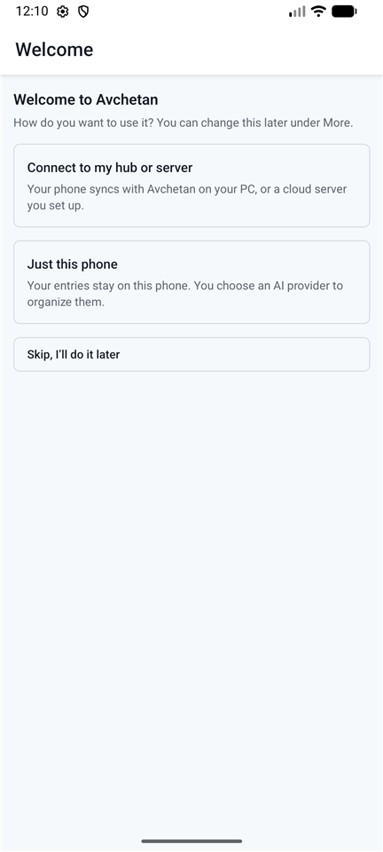

# Setup: Just one device

**Goal:** use Avchetan on a single PC or a single phone.
**You need:** the Avchetan installer (Windows) or app (Android), plus **either** the free [Ollama](https://ollama.com) app on your PC (private, free AI) **or** an API key from an AI provider.

## Steps (Windows)

1. Download the Avchetan installer (the file ending in `windows-x64-setup.exe`) from the project's GitHub Releases page, and run it. If Windows says **Windows protected your PC**, click **More info**, then **Run anyway**: the installer isn't signed with a certificate yet.
2. On the **Welcome to Avchetan** screen, choose **Just this PC**.
3. Choose the AI that organizes your entries: Ollama on this PC if you have it, or a provider with an API key ([details](ai-models.md)).
4. Click **Finish**. The shortcut is **Ctrl+Shift+Space**; you can change it in **Settings**.

## Check it worked

Press **Ctrl+Shift+Space**, type `Walked 30 minutes, remind me to buy milk tomorrow` and press Enter. Within a few seconds the entry shows a ✓, with an activity and a task underneath.

## Steps (Android)

1. Install the Avchetan app and open it. On **Welcome to Avchetan**, tap **Just this phone**.

2. Choose a provider and paste your API key ([details](ai-models.md)).

## Later

To add another device, switch to [Home Hub](setup-home-hub.md) or [Cloud](setup-cloud.md). Everything you've entered is uploaded on the first sync.
