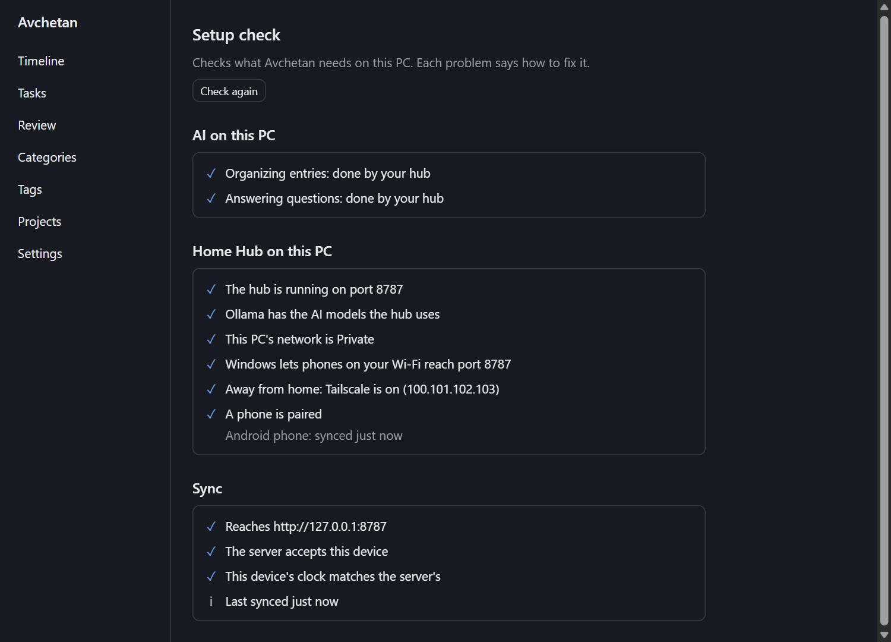

# Troubleshooting

Each section heading matches an error code shown in the app, so the app's **Help** links land here.

## Setup check

Start with the **Setup check**. It tests everything and tells you what to fix.

- **Windows:** **Settings → General → Setup check**, or the **Setup check** link next to a sync error.
- **Android:** **More → Setup check**, or the **Setup check** link next to a sync error.

It checks:

- **Sync:** whether each saved address of your hub or server answers, whether it accepts this device's token, and whether this device's clock matches the server's.
- **AI:** whether the models this device uses can work: Ollama running, the model downloaded, or the API key saved. A phone that lets the hub organize or answer also sees the hub's own models, so it can tell you when Ollama has stopped on the PC.
- **Home Hub on this PC** (Windows, when the hub is on): the hub running, its models in Ollama, the network Private, the firewall rules, Tailscale, and the paired phones.

Problems come first, each with its fix and a **Help** link to its section below. Click **Check again** after fixing something.

## unauthorized
**"Your hub or server refused this device's sync token"** or **"Your hub doesn't know this device. Pair it again."** The sync token changed or was rotated, or the hub lost what it knew about this device. Pair the device again ([Pair your phone](pair-your-phone.md)).

## server_unreachable
**"Can't reach your hub or server."**
- Home Hub: is the PC on and is Avchetan's tray icon green? Is the phone on the same Wi-Fi (or Tailscale connected)? Is the Windows Wi-Fi network set as *Private*?
- Cloud: open `https://<your-domain>/v1/health` in a browser.

## clock_skew
**"This device's clock is wrong"** or **"This device's clock is … minutes behind (or ahead of) the server's."** The server refuses changes stamped more than 5 minutes in its future. Turn on automatic date & time in the device settings: on Android, the Setup check's **Open date & time settings** goes there; on Windows, **Settings → Time & language → Date & time → Set time automatically**. If the device's clock is right, the server's is wrong: fix it on the hub's PC or server the same way.

## untrusted_local_network
**"Turn on Trust this home network to use this address."** The address is on your home network and uses plain `http://`, so your sync token travels unencrypted on that Wi-Fi. Turn on **Trust this home network** if you trust everyone on it, or connect through [Tailscale](remote-access-tailscale.md), which encrypts it.

## insecure_server_url
**"This address needs https://."** Plain `http://` only works on this device, on a home network or through Tailscale. Anywhere else your token would cross the internet unprotected, so use the server's `https://` address.

## insecure_model_url
**"This address needs https://."**, when you save an Ollama address in **AI models**. Avchetan sends your entries to that address, so plain `http://` only works on this device, on a home network or through Tailscale. For an Ollama elsewhere on the internet, put it behind `https://`, or reach it through [Tailscale](remote-access-tailscale.md).

## sync_issue
**"Changes keep failing to sync."** The server refused these changes ten times, so they're waiting and nothing is lost. Check that both devices run the same version of Avchetan, then report it if it doesn't clear.

## not_configured
**"Set up Sync on this device first."** Pairing a phone, changing the token and asking your hub all need this device connected to a hub or server. On the PC, fill in **Settings → Hub & sync → Sync**; on the phone, use **More → Sync → Scan pairing code** ([Pair your phone](pair-your-phone.md)).

## invalid_pairing_code
**"This isn't an Avchetan pairing code."** The camera read a different QR code. On the PC, open **Settings → Hub & sync → Sync → Pair a phone** (or the checklist in **Home Hub on this PC**) and scan the code shown there.

## wrong_server
**"A different Avchetan server answered at that address."** The address in the pairing code now belongs to another Avchetan hub, for example after you set up a new hub on another PC that got the same address. Show the pairing code again on the PC whose hub you want, and scan that one.

## no_pairing_address
**"The hub doesn't know an address a phone can reach."** The hub found no Wi-Fi or Tailscale address on its PC. Check that the PC is connected to your home Wi-Fi (or Ethernet), then show the code again. Away from home, start Tailscale on the PC first ([Use your phone away from home](remote-access-tailscale.md)).

## token_from_env
**"This server's token is set in its SYNC_TOKEN setting."** A server you run yourself (cloud, or `start:hub` from the source code) takes its token from the `SYNC_TOKEN` setting, so **Change token** can't replace it. Put a new token into `SYNC_TOKEN` where the server is set up, restart the server, then pair every device again.

## protocol_unsupported
**"This app and your hub or server are different versions. Update the older one."** Install the latest Avchetan on every device, and update the server if you run one yourself. Your entries wait on each device until they can sync.

## rate_limited
**"Your hub got too many requests from this device."** The hub accepts 60 requests a minute from one device. Avchetan waits and tries again by itself; nothing is lost. If it keeps happening, quit and restart Avchetan on that device.

## server_error
**"Your hub or server answered with an error"**, **"Your hub or server sent something unexpected"**, **"Your hub or server didn't accept the request"** or **"Your hub or server can't reach its database."**
- Check that every device and the server run the same version of Avchetan.
- Home Hub: open **Settings → Hub & sync → Home Hub on this PC → Recent hub log** on the PC for the reason.
- Cloud: open the server's log, and `https://<your-domain>/v1/health` in a browser.
- Your changes wait on the device and sync once the server answers normally.

## ask_unavailable
**"Your hub can't answer questions right now."** The hub has just started, or has no model for answering. Wait a minute and ask again. If it keeps failing, open the Setup check: it shows whether the hub's Ollama runs and has its models. You can also let this device answer with its own model in **AI models**.

## command_unknown
**"Couldn't read this as a command."** You typed something after `/` that isn't one of the commands (`/done`, `/brief`, `/sync`, `/undo`), and the AI couldn't map it to one either. Type `/` alone to see the list. To save an entry that starts with `/`, begin it with `//` ([Commands](commands.md)).

## command_no_match
**"No open task matches …"** `/done` looks for an open task containing the words you typed. Check the spelling, use a word from the task's title (the start of a word is enough, like `plumb` for "plumber"), or find the task in **Tasks**. A task that's already done can't match.

## search_unavailable
**"Your hub can't search by meaning right now."** The hub's search model isn't set up or didn't answer, often because Ollama isn't running on the hub's PC. Ask still works, searching by words instead. Open the Setup check to see which model is missing.

## llm_auth
**"The provider rejected the API key"** or **"No API key is set for this provider."** Paste the key again in **Settings → AI → AI models** and click **Test**. Your entries wait safely and are organized once the key works.

## llm_rate_limit
**"The provider is rate limiting requests."** Normal on a free plan. Your entries wait and are organized automatically; nothing is lost. If you often reach the limit, check your provider's usage page.

## llm_unavailable
**"The model could not be reached"**, **"took too long to answer"**, **"was interrupted too many times"**, **"is not downloaded in Ollama"**, **"The provider doesn't offer this model"** or **"The provider is overloaded right now."**
- A note in brackets, such as *HTTP 503*, is what the provider answered. With no note, the request got no answer at all, so check your connection.
- Interrupted: the phone stopped the app while it was working. Open the entry and tap **Organize now**. If this keeps happening, let Avchetan run in the background in your phone's battery settings.
- Ollama: is the Ollama app running in the tray?
- Model not downloaded: see [model_missing](#model_missing), then click **Test** again.
- Took too long: a large model on a PC without a graphics card can be slow. Try a smaller model.
- Doesn't offer this model: the model name is mistyped, retired, or not available on your account. Copy the exact name from the provider's model list into **Model**, then click **Test**.
- Overloaded: the provider is busy. Avchetan tries again by itself later.
- Cloud provider: possibly a temporary outage. Entries are retried automatically.

## llm_invalid_output
**"The model returned an unusable answer."** Avchetan tries again by itself. If an entry keeps failing, try a larger model in **Settings → AI → AI models**.

## llm_refused
**"The model returned no answer."** The provider declined this entry or sent back nothing. Avchetan won't retry it by itself, as the answer would likely be the same. Your entry is still saved.

## llm_context_overflow
**"The request is too long for this model."** The entry and the instructions Avchetan sends with it don't fit in what the model can read at once. Avchetan first tries again with shorter instructions by itself. If an entry still fails, split it into shorter entries, or choose a model that reads longer text in **Settings → AI → AI models**.

## llm_no_credit
**"The provider account has no credit left."** OpenAI and Anthropic charge per use, and your account's balance or monthly limit has run out. Add credit or raise the limit on the billing page of the provider's website, then click **Test** in **Settings → AI → AI models**. Until then your entries wait safely. To keep going for free, choose Groq or Ollama instead.

## hotkey_unavailable
**"The shortcut is used by another app."** Choose another shortcut in **Settings → Capture box → Shortcut** (or, for the clipboard shortcut, **Settings → Capture box → Clipboard snap**).

## mic_unavailable
**"No microphone found. Plug one in, or pick one in Settings → Voice."** Avchetan couldn't open a microphone for [voice](voice.md). Plug one in (or turn on the laptop's), then try again. If you have several, pick the one you talk into in **Settings → Voice → Microphone** and press **Test**: the bar should move when you speak. On Windows, also check **Settings → System → Sound → Input**.

## mic_permission_denied
**"The microphone is blocked for Avchetan."**
- **Windows:** open **Settings → Privacy & security → Microphone**, turn on **Microphone access** and **Let desktop apps access your microphone**, then try again.
- **Android:** long-press the Avchetan icon → **App info → Permissions → Microphone → Allow only while using the app**.

## speech_model_missing
**"Voice needs a speech model. Download one in Settings → Voice."** The PC turns speech into text with a Whisper model that runs on your PC, and none is downloaded yet. Open **Settings → Voice**, choose a model and press **Download** (about 150 MB; once). See [Voice](voice.md#on-the-pc).

## speech_model_download_failed
**"The speech model didn't download. Check your connection and try again"** or **"Couldn't delete the speech model. Restart Avchetan and try again."** The download stopped, or the file didn't match its checksum, so Avchetan threw it away. Check your internet connection and press **Download** again; it starts from the beginning. If deleting failed, quit Avchetan from the tray, start it again and press **Delete** again.

## speech_offline_unavailable
**"This phone can't recognise speech offline in that language yet."** Avchetan uses your phone's own speech recognition and never sends your voice to Google's servers, so the language has to be on the phone. Open Android **Settings**, search for **On-device speech recognition** (or **Offline speech recognition**), and download **Hindi (India)** or **English (India)**, whichever you chose in **More → Voice**. Some phones have no on-device recognition at all; there, type instead. See [Voice](voice.md#on-the-phone).

## speech_unsupported_cpu
**"This PC's processor is too old for voice. Typing still works."** The PC's speech model needs a processor from about 2013 or later (one with AVX2, which nearly every Intel Core and AMD Ryzen has). Older and some low-power processors don't have it. Everything else in Avchetan works; on such a PC, use voice on your phone instead ([Voice](voice.md#on-the-phone)).

## transcription_failed
**"Couldn't turn that into text. Try again."** Your recording wasn't saved anywhere, so say it again. If it keeps failing, open **Settings → Voice**, press **Delete** and **Download** the model again (the file may be damaged), or try the other model.

## database_unavailable
**"Avchetan couldn't open its database"**, **"Avchetan couldn't update its database"** or **"The database is busy. Try again in a moment."** Avchetan keeps your entries in a file in your user folder, and it couldn't open that file.
- Right-click the tray icon → **Quit Avchetan**, then start it again from the Start menu.
- Check that your disk isn't full.
- If you use a backup or sync tool (OneDrive, Dropbox) on `%APPDATA%\app.avchetan`, exclude that folder. Those tools can lock the file while Avchetan is using it.
- On Android: close the app fully and open it again, and check that your phone has free storage.

## db_query_failed
**"Couldn't save this entry"** or **"Couldn't save this change."** Your text stays in the box, so nothing is lost. Press Enter to try again. If it keeps failing, quit and restart Avchetan, then see [database_unavailable](#database_unavailable).

## db_newer_than_app
**"Your data was saved by a newer Avchetan. Install the latest version."** A newer version of Avchetan updated this device's database, and this older version can't read it safely, so it doesn't touch it. Install the latest version of Avchetan; your entries are all there. If you restored an older app on purpose, keep the newer one instead.

## secret_store_failed
**"Couldn't reach this device's password store, where Avchetan keeps keys and tokens."** Avchetan keeps API keys and the sync token in Windows Credential Manager (on Android, the phone's keystore), never in its own files. Restart Avchetan. On Windows, if it keeps failing, restart the PC: the Credential Manager service may have stopped. Nothing is lost, but sync and cloud models wait until the key or token can be read.

## dock_unavailable
**"The capture box isn't responding."** Your change wasn't saved. Right-click the tray icon → **Quit Avchetan**, start it again, and repeat the change.

## backup_failed
**"Couldn't back up the database."** Your entries are fine; only the copy failed. Check that the disk (or the phone) has free space, then try **Back up now** in **Your data**. Avchetan tries again every hour on its own.

## backup_invalid
**"Invalid backup name."** This is a bug in Avchetan, not something you did. Please report it; your data is not affected.

## export_failed
**"Couldn't save the export."** Check that the disk has free space. On Android, pick a folder you can write to, such as *Downloads*, and try again.

## export_invalid
**"Invalid export file name."** This is a bug in Avchetan, not something you did. Please report it; your data is not affected.

## open_failed
**"Couldn't open the folder."** Open File Explorer and go to the folder by hand: `%APPDATA%\app.avchetan\backups` for backups, or `Documents\Avchetan exports` for exports.

## restore_target_not_empty
**"The data folder is not empty."** A hub restore never overwrites data. Stop the hub, rename the `pglite-data` folder, and run the restore again ([Back up and restore](backup-and-restore.md#restore)).

## hub_port_in_use
**"Couldn't start: another program is using port 8787."** Usually a hub you started by hand in a terminal (`start:hub`) or with Docker is still running. Stop it: press **Ctrl+C** in its window, or run `docker compose -f deploy/home-hub/compose.yml down`. Then click **Turn on the hub** again.

## hub_crashed
**"Couldn't start the hub."** The hub stopped five times in a row soon after starting. Open **Settings → Hub & sync → Home Hub on this PC → Recent hub log** and look at the last lines:
- `database setup problem` or `startup failed`: the line names the cause.
- Nothing useful: quit Avchetan from the tray, start it again, and turn on the hub. If it still fails, restore the hub's data from a backup ([Back up and restore](backup-and-restore.md)).

## hub_program_missing
**"The hub program isn't installed with this copy of Avchetan."** Install Avchetan again from the installer. In a development copy, build it first: `pnpm --filter @avchetan/server build:sidecar`.

## hub_token_missing
**"The hub has no sync token yet."** Turn the hub off and on again in **Settings → Hub & sync → Home Hub on this PC**. Avchetan makes a token when it turns the hub on.

## hub_config_failed
**"Couldn't save the hub's settings."** Avchetan writes them to `%APPDATA%\app.avchetan\hub\hub.json`. Check that the disk isn't full, and that a backup or sync tool (OneDrive, Dropbox) isn't locking that folder. Then try again.

## hub_import_failed
**"Couldn't copy the hub data."** Copying the `pglite-data` folder stopped partway, usually because the disk is full or another program has the folder open. Nothing was changed: the built-in hub still has no data, and the folder you chose is untouched. Make room on the disk, close the program that started the old hub, and try again.

## hub_import_not_hub_data
**"That folder doesn't hold hub data."** Choose the folder named `pglite-data` itself, not the folder around it. For a hub started from the source code, it is `avchetan-code\apps\server\pglite-data`.

## hub_import_target_not_empty
**"The built-in hub already has data."** Avchetan never overwrites a hub's data. To use other data instead, turn the hub off, quit Avchetan, rename `%APPDATA%\app.avchetan\hub\pglite-data`, and try again.

## hub_restore_failed
**"The backup couldn't be restored; the hub kept its data."** Nothing changed: the hub is back on the data it had. Open **Recent hub log** for the reason. Try an older backup, or check that the disk isn't full.

## hub_backup_invalid
**"Not a hub backup, or that backup is gone."** The file was renamed or deleted. Close and reopen **Hub backups** to see the backups that are there.

## hub_backup_failed
**"Couldn't read the hub's backups."** Avchetan couldn't open `%APPDATA%\app.avchetan\hub\backups`. Check that a backup or sync tool isn't locking it, then close and reopen **Hub backups**. The hub keeps making its daily backups regardless.

## hub_running
**"Turn the hub off before using other hub data."** Click **Turn off the hub** first.

## ollama_not_running
**"Ollama isn't running on this PC."** Install Ollama from [ollama.com/download](https://ollama.com/download) and open it once; it then runs in the background and starts with Windows. Click **Check again**. If it is installed, look for its llama icon in the taskbar tray, or open it from the Start menu.

## model_missing
**"Ollama hasn't downloaded"** a model. Ollama runs, but the model Avchetan is set to use isn't on that PC yet, so entries wait to be organized.
- On this PC: click **Download it** in the Setup check. For the hub's models, use **Download them** in **Settings → Hub & sync → Home Hub on this PC**. Models are a few GB, so this takes a while.
- On a phone, the message is about the hub's PC: open Avchetan on that PC and download the models there.

## network_public
**"Your network is set as Public."** Windows blocks phones from reaching a PC on a Public network. For your home network only, open **Settings → Network & internet → Wi-Fi** (or **Ethernet**), click the network, and set **Network profile type** to **Private**. Keep café, office and hotel networks Public.

## firewall_declined
**"Windows wasn't allowed to add the firewall rule."** You clicked **No** when Windows asked. Click **Allow phones to connect** again and choose **Yes**. Your Windows account needs to be an administrator; if it isn't, ask whoever manages the PC to approve it.

## firewall_failed
**"Adding the firewall rule failed."** Add the rules by hand instead: [Setup: Home Hub, Let your phone reach the PC](setup-home-hub.md#let-your-phone-reach-the-pc) and the rule in [Tailscale](remote-access-tailscale.md). Some antivirus programs replace the Windows firewall; then allow port 8787 in that program instead.

## network_check_failed
**"Couldn't check this PC's network."** Avchetan asks Windows PowerShell about the network and firewall, and it didn't answer. Restart Avchetan. Phones can still connect if the network is Private and the firewall rule exists ([Setup: Home Hub, Let your phone reach the PC](setup-home-hub.md#let-your-phone-reach-the-pc)).

## tailscale
**"Tailscale isn't running."** This is optional. To sync with your phone away from home, follow [Use your phone away from home](remote-access-tailscale.md).

## database_url_invalid
**Cloud server log: "DATABASE_URL is not a valid address."** Usually the database password contains `#`, `/`, `?` or `%`, which break the address. Reset the database password to one with only letters and numbers, build the line again ([Setup: Cloud server](setup-cloud.md#part-1--the-database-supabase), Part 1, step 4), and paste it into `DATABASE_URL`. Also check that it starts with `postgresql://`, has no spaces, and that `[YOUR-PASSWORD]` was replaced including the square brackets.

## database_ipv6_unreachable
**Cloud server log: "The database address is IPv6 only."** You copied Supabase's **Direct connection** string. In Supabase, click **Connect**, change **Method** to **Session pooler**, and use that string. Its host ends in `pooler.supabase.com` and the user is `postgres.` followed by your project id.

## database_certificate_missing
**Cloud server log: "The database certificate file … is missing."** In Render, open your service → **Environment → Secret Files**, and check that there's a file named exactly `supabase-ca.crt` holding the certificate you downloaded from Supabase.

## database_password_wrong
**Cloud server log: "The database rejected the password."** Reset the database password in Supabase (**Project Settings → Database**), and put the new one into `DATABASE_URL` in place of the old one.

## other_errors
**"Something inside Avchetan went wrong. Restart it; if it happens again, please report it"**, **"The app needs a restart"**, or an error whose **Help** link brought you here. This is a bug in Avchetan, not something you did.
1. Quit Avchetan (on Windows: right-click the tray icon → **Quit Avchetan**; on Android: close it from recent apps) and open it again.
2. Run the [Setup check](#setup-check).
3. If it happens again, [report it on GitHub](https://github.com/tulsiram-sunrise/avchetan/issues/new?template=bug-report.yml) (Windows: **Settings → General → About → Report a problem**; Android: **More → Report a problem**), with the error text and what you were doing. Don't include your entries or tokens.

## Entries stay "pending"
Normal when offline or when the hub is unreachable. They are processed automatically later. If they stay pending while everything is connected, open **Review** in the main window: it shows the reason for each entry.

## Daily brief
**"Couldn't make the brief"** shows the reason and a **Help** link for it, usually [llm_auth](#llm_auth), [llm_no_credit](#llm_no_credit), [llm_rate_limit](#llm_rate_limit) or [server_unreachable](#server_unreachable). After fixing it, click or tap **Try again**.
- **No brief on a day:** a day without entries gets none, and a brief you deleted isn't made again by itself. Use **Make a brief** on that day.
- **No brief on the phone at the brief time:** expected. Android doesn't let apps run on time in the background, so the phone makes it when you open Avchetan or tap the reminder.
- **No Windows notification:** check that notifications for Avchetan are on in Windows **Settings → System → Notifications**, and that *Do not disturb* is off.
- **No reminder on the phone:** turn **Remind me** on in **More → Daily brief**, and allow notifications for Avchetan in Android's settings. Reminders come only on days you logged something.

More in [Daily brief](daily-brief.md).
